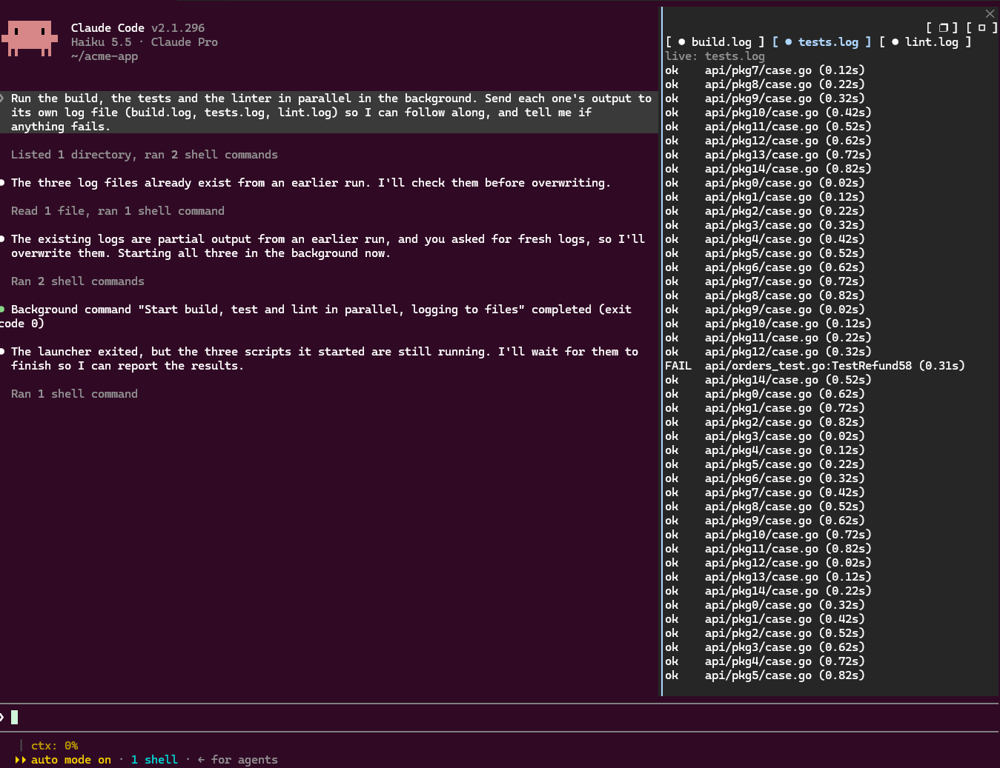

# logpane

logpane is a Claude Code mod. It shows the files that your Bash commands write to. A band above the prompt lists the files. A pane shows the lines of one file.



Example: Run `make > build.log 2>&1` through Claude Code. Watch `build.log` fill in the pane. You do not need a second terminal.

## Install

To try logpane from a clone, run this command:

```
claude --plugin-dir ~/git/logpane
```

To install logpane for normal use, run this command:

```
/plugin install logpane --marketplace benlrice/logpane
```

Enter `y` to add the marketplace. Then select a scope.

## Use

logpane starts when the session starts. Before each Bash command runs, logpane reads the command. It finds the files that the command writes output to. Then it watches these files.

### The band

The band opens by itself when a watched file goes live. It is one row above the prompt. It has one button for each watched file, for example `1 ● build.log  2 ○ test.log`, and a `✕` button.

- To open the pane on a file, click its button, or press its number key.
- The number keys work when the band has the keyboard. Press `ctrl+x`, then `Tab`, or click the band.
- To hide the band, press `✕`. The band stays hidden until a watched file goes live again, or until a new Bash command writes to a file.
- The band hides when no watched file is live.
- The band and the pane are never on screen together. When you close the pane and a file is live, the band comes back.

### The pane

The pane opens when you press a file button in the band, or when you enter `/logpane`. The pane never opens by itself.

The pane has these parts:

- One button for each watched file. The button shows the file name. If two files have the same name, the button shows `dir/name`.
- A header. The header is `live: <name>` or `ended: <name>`.
- The last lines of the selected file.

Each button shows a mark:

- `●` means live. A process has the file open for writing, or a foreground Bash command is running against it.
- `○` means ended.

A background command returns at once. Its file is live until its process exits. logpane checks every 2 seconds with `lsof`.

### Keys

| Key | Action |
| --- | --- |
| Tab or arrow keys, then Enter | Move between the buttons. Press a button. |
| 1 to 8 | Select the file with that number. |
| m | Maximize the pane. Press the key again to restore the pane. |
| Esc | Close the pane. Remove the ended files. The band comes back if a file is live. |

The pane shows the newest file. When you press a button or a number key, the pane keeps your selection.

When you enter `/logpane` again, logpane does these things:

1. It removes the ended files.
2. It removes your selection.
3. It opens the pane with the keyboard focus.

When you close the pane, logpane removes the ended files. The live files stay.

## Which files logpane watches

| Command | Watched files |
| --- | --- |
| `cmd > out.log`, `cmd >> out.log` | `out.log` |
| `cmd \| tee out.log`, `cmd \| tee -a out.log` | `out.log` |
| `cmd > a.log 2> b.log` | `a.log`, `b.log` |
| `&> f`, `&>> f`, `1> f`, `>\| f` | `f` |
| `tee [-a -i -p] f1 f2 ...` | Each file operand |
| `> "my build.log"`, `> 'a b.log'` | The quoted path |
| `a && b > x.log; c \| tee y.log` | `x.log`, `y.log` |
| `2>&1` and other fd duplications | None |
| `/dev/null`, `/dev/stdout`, `/dev/stderr`, `/dev/tty`, `/proc/*` | None |
| A path with `$VAR`, `~`, a backtick, `*` or `?` | None (logpane cannot expand the path) |
| A redirect in `$(...)`, in backticks or in a heredoc body | None |

If logpane cannot read a part of a command, it skips that part. It does not guess.

logpane resolves a relative path from the working directory of the session. It uses `tail -F` to follow a file that does not exist yet. It also uses `tail -F` for a file that the system truncates or rotates.

## Limits

- logpane watches 8 files at the same time. When a ninth file arrives, logpane removes the oldest file and stops its tail.
- logpane starts each file from its last 200 lines. It keeps the last 300 lines.
- logpane reads only the redirects in the command text. It does not follow these items: files that a program opens by itself, shell variables, globs, `cd` in a compound command, and command substitutions.
- logpane decides live or ended from the processes that have the file open for writing. This needs `lsof`. Without `lsof`, a file is live for 20 seconds after its last output.
- logpane has no scrollback past 300 lines, no search and no filter. It has no automatic open of the pane, no status-line hint and no settings.

## Development

To check and test the mod, run these commands:

```
claude plugin validate .
claude plugin test .
```

logpane has the MIT license.
